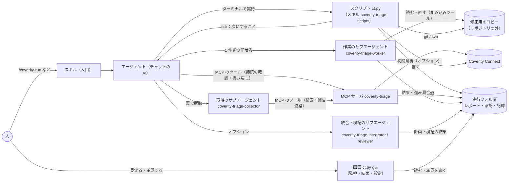

# 開発する人へ

## 資料

| 資料 | 内容 |
|---|---|
| [spec.md](spec.md) | 何を作るか（目的、使い方、成功の基準、機能、決定の記録） |
| [design.md](design.md) | どう作るか（部品の役割、処理の流れ、ファイルの形、根拠にした公式仕様） |
| [selftest.md](selftest.md) | 社内の環境での動作確認の手順 |
| [sample-output/](sample-output/README.md) | 一覧と詳細レポートの見本（HTML と Markdown） |

## 仕組み（あらまし）

公式の役割分担に合わせて部品を分けています（詳しくは [design.md](design.md) の 1 章）。



| 部品 | 場所 | 役割 |
|---|---|---|
| スキル（入口） | `plugins/coverity-triage/skills/coverity-*/` | 人が `/` で呼ぶ手順 |
| スクリプト | `skills/coverity-triage-scripts/scripts/ct.py`、`ctlib/` | 決まった処理（実行の順番 `tick`（`ctlib/flow.py`）、初回解析（`ctlib/initial.py`）、実行フォルダ、グループ化、統合の候補と反映、修正用のコピー、差分とブランチ、レポート、人に見せる確信度（`ctlib/assess.py`）、承認、反映、動作確認） |
| 画面 | `ctlib/gui.py`、`ctlib/gui.html`、`ctlib/activity.py` | PC の中だけで動くブラウザの画面。監視（エージェントの動きと重大なエラー）、結果（一覧・詳細・承認の入力）、設定 |
| MCP サーバ | `plugins/coverity-triage/server/` | Coverity との通信だけ（接続の確認、検索、警告経路、書き戻し） |
| サブエージェント | `com.github.copilot/agents/*.agent.md` | 4 つ。取得（`coverity-triage-collector`。Coverity から読むだけ。使えるのは読み取りと MCP の `search_issues`・`get_issues` だけ）、作業（`coverity-triage-worker`。警告 1 件を調べて 2 つの案を書く）、統合（`coverity-triage-integrator`。オプション。同じ原因の作業をまとめる計画を書く）、検証（`coverity-triage-reviewer`。オプション。結果を独立に確かめる）。作業・統合・検証で使えるのは読み取り・検索・編集・スキルだけ |
| スキル（知識） | `skills/triage-investigation/` など 7 つ | サブエージェントが読む調べ方・書き方（統合は `triage-integration`、検証は `triage-review` も） |

取得・統合・検証のサブエージェント、`tick`、初回解析は、Copilot CLI だけを対象に作っています（[spec.md](spec.md) の決定 50）。今ある VS Code 向けの部分は残してあります。

## テスト

リポジトリの一番上で実行します（uv が要ります。svn のテストは svn が無ければ飛ばします）。

```
uv run pytest
```

| テスト | 確かめること |
|---|---|
| `tests/server/` | MCP サーバ（偽の Coverity の応答、時間で区切って続きを返すこと、`mcp.json` と同じ起動方法でつながること） |
| `tests/scripts/` | スクリプト（実行から反映までの流れを git と svn で、準備、オプション、動作確認のコマンド、HTML のレポートと承認、画面のサーバ、監視の状態） |
| `tests/test_plugin_files.py` | プラグインのファイルの形（スキルとサブエージェントの frontmatter、`mcp.json`）、スキルに書いたコマンドとツールが実在すること |

テストは偽の Coverity と見本のリポジトリで動かします。サブエージェントの役はテストが代わりに行う（決まった修正と結果ファイルを書く）ので、AI の判断の質はテストしません。初回解析の登録（`cov-commit-defects`）は、偽の Coverity（`coverity.api: fake`）では記録だけになります。AI の判断や、Copilot の上での動き（ツールの許可、サブエージェントの起動、スキルの読み込み）は、`/coverity-selftest` と [selftest.md](selftest.md) の手順で確かめます。

## 見本の作り直し

レポートや一覧の形を変えたら、見本を作り直します。見本は `options.markdown` を true にして作るので、HTML と Markdown の両方ができます（GitHub の上では Markdown が読めます）。

```
uv run python tests/tools/make_sample_output.py
```

## 画面を試す

画面（`gui.html`）を変えたときは、ブラウザで実際に開いて確かめます。`<実行フォルダ>` には、`/coverity-selftest` の ② や、ふだんの `/coverity-run` でできた実行フォルダを使います。

```
uv run --native-tls plugins/coverity-triage/skills/coverity-triage-scripts/scripts/ct.py gui --repo <リポジトリ> --run <実行フォルダ>
```

- 明るいテーマと暗いテーマ、幅 360px の狭い画面でも、横にはみ出さないこと。
- 外部のフォントやライブラリを使わないこと（CSP で止まります）。
- 同じリポジトリの画面が動いていると、それを使い回します。ただし `ctlib/` や `ct.py` を変えたあとの `ct.py gui` は、古いスクリプトで動いている画面を止めて起動し直します（開いていたタブは使えなくなるので、新しく開いたタブを使います）。

## 版数

プラグインを変えたら、`plugins/coverity-triage/plugin.json` と `.github/plugin/marketplace.json` の `version` をそろえて上げます（`tests/test_plugin_files.py` が確かめます）。
MCP サーバの依存ライブラリを変えたら、`plugins/coverity-triage/server` で `uv lock` を実行して `uv.lock` を更新します（MCP サーバは `uv run --frozen` で起動するため）。
