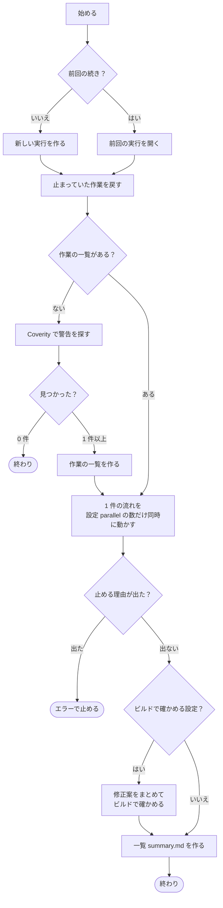
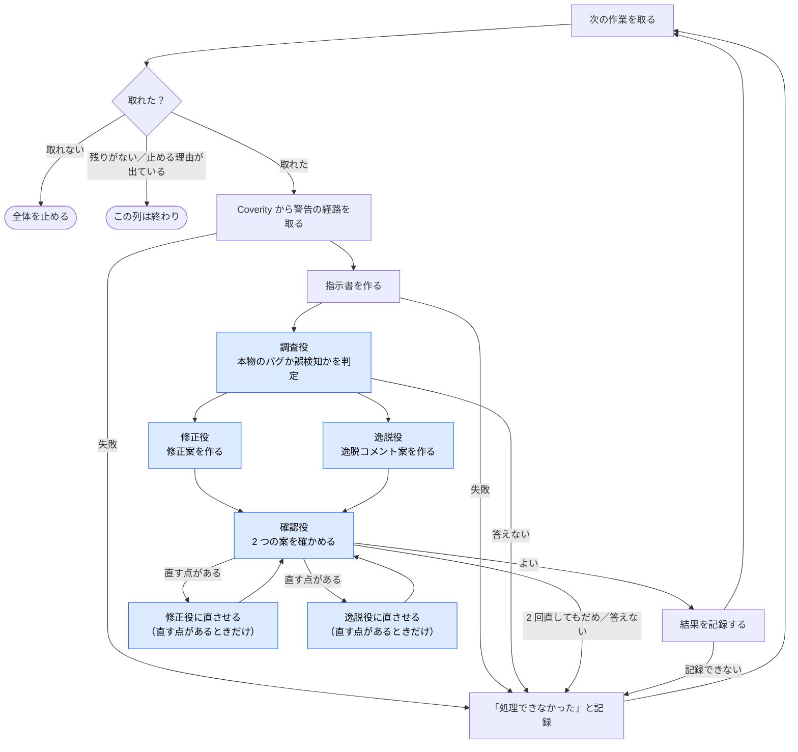

# dynamic workflow coverity-triage-run の図

[`extension.mjs`](../plugins/coverity-triage/com.github.copilot/extensions/coverity-triage-run/extension.mjs) の流れを、そのまま図にしたものです。
箱の ID（`S1` など。図には出ません）は、`extension.mjs` のコメント `// [S1]` と対応します。
図を直したら、AI に「この図に合わせて `extension.mjs` を直して」と頼みます。

白い四角はプログラムの処理、青い四角は AI（カスタムエージェント）、ひし形は分かれ道、丸は終わりです。
ラベルの無い矢印が 1 つの箱から 2 本出ているところは、両方を同時に動かします。

## 全体の流れ

## 1 件の流れ

## 呼ぶ AI

| 役 | カスタムエージェント | 渡すもの | 返してもらうもの |
|---|---|---|---|
| 調査役 | `coverity-triage-investigator` | 指示書 | 判定、推奨、確信度とその理由、コードのずれ、グループから外す CID |
| 修正役 | `coverity-triage-fixer` | 指示書、調査役の判定（直すときは前の案と直す点） | 分類の案、直した内容、影響、守れなかった決まり、もう直っているか |
| 逸脱役 | `coverity-triage-deviation` | 指示書、調査役の判定（直すときは前の案と直す点） | 分類の案、逸脱コメント |
| 確認役 | `coverity-triage-reviewer` | 指示書、調査役の判定、2 つの案 | よいか、修正案の直す点、逸脱案の直す点 |

## 画面に出る段階

| 段階 | 内容 |
|---|---|
| 準備 | 新しい実行を作る、または前回の実行を開く |
| 検索 | Coverity で警告を探す |
| 計画 | 作業の一覧を作る |
| 調査 | 作業を 1 件ずつ調べる |
| 検証 | 修正案をまとめてビルドで確かめる（設定したときだけ） |
| 一覧 | 一覧 summary.md を作る |

## 始めるときに渡すもの

| 名前 | 意味 |
|---|---|
| `repo_root` | 調べるリポジトリの一番上のフォルダ（新しく始めるとき） |
| `run_dir` | 前回の実行フォルダ（続きから再開するとき） |
| `filter` | 条件ファイルの名前 |
| `impact` | Impact で絞る |
| `checker` | チェッカー名で絞る |
| `status` | Status で絞る |
| `classification` | Classification で絞る |
| `action` | Action で絞る |
| `limit` | 件数の上限 |
| `verify` | ビルドで確かめるか（`none` / `build` / `build+analyze`） |
