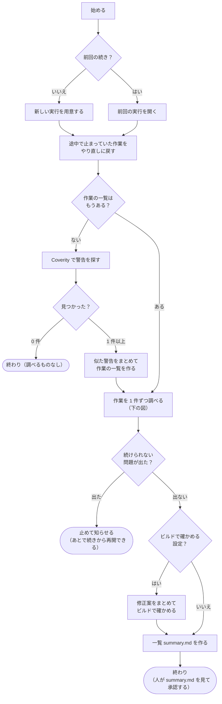
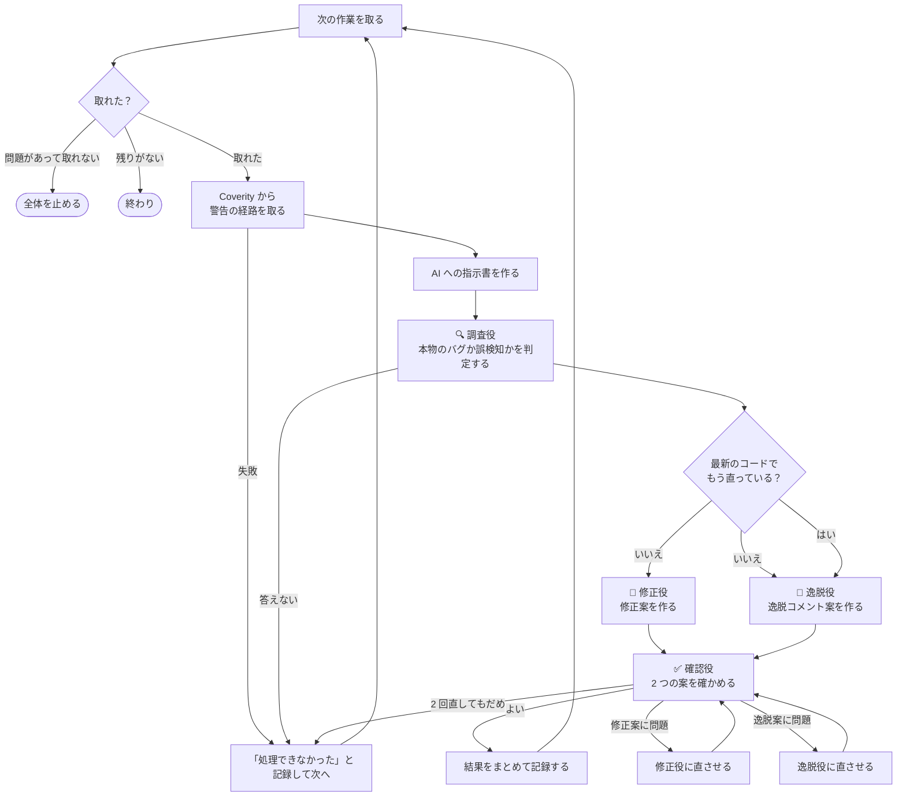

# Coverity トリアージの自動実行（dynamic workflow）の流れ

Copilot CLI で `/coverity-run` と同じトリアージを自動で進めるときの手順です。
**この図が手順の正本です。** 手順を変えたいときは、この図を直してから、AI に「`workflow/coverity-triage-run.md` に合わせて `extension.mjs` を直して」と頼みます。

## 全体の流れ

## 1 件の調べ方

4 つの役の AI が、順に受け渡しながら進めます。

修正役と逸脱役は同時に動きます。

## 4 つの役

| 役 | すること | 受け取るもの | 渡すもの | 使えるもの |
|---|---|---|---|---|
| 🔍 調査役 | コードを読み、本物のバグか誤検知か意図的かを判定する。推奨（修正／逸脱）と確信度も決める | 指示書 | 判定・根拠・推奨・確信度 | 読む・探す。スキル：調べ方、チェッカー別の観点 |
| 🔧 修正役 | 修正用のコピーを最小限に直す | 指示書、調査役の判定 | 何をどう直したか、影響 | 読む・探す・直す（修正用のコピーだけ）。スキル：修正の決まり |
| 📝 逸脱役 | 逸脱コメントと、分類（Classification / Action / Severity）の案を書く | 指示書、調査役の判定 | 逸脱コメント、分類の案 | 読む・探す。スキル：逸脱コメントの書き方 |
| ✅ 確認役 | 2 つの案が判定と合っているか、決まりを守っているかを確かめる | 指示書、3 役の結果、修正の差分 | よい／直す点（修正案・逸脱案のどちらか） | 読む・探す。スキル：調べ方、修正の決まり、逸脱コメントの書き方 |

- どの役もターミナルと Coverity は使いません。
- 今の 1 人の AI（`coverity-triage-worker`）を、この 4 つに分けます。

## 決まりごと

- 始めたら、終わるまで人に質問しません（夜間に人がいなくても進むように）。
- Coverity への書き込みやプルリクエストの作成（反映）はしません。反映は、人が承認してから `/coverity-apply` で行います。
- 処理できなかった作業は飛ばして記録します。続きから再開すると、その作業をやり直します。
- 同時に調べる数は、設定 `config.yaml` の `parallel` で決まります（既定 1）。

## 画面に出る段階

`/workflows` の画面に、いまどの段階かが出ます。

| 段階 | 内容 |
|---|---|
| 準備 | 新しい実行を用意する、または前回の実行を開く |
| 検索 | Coverity で警告を探す |
| 計画 | 似た警告をまとめて作業の一覧を作る |
| 調査 | 作業を 1 件ずつ調べる |
| 検証 | 修正案をまとめてビルドで確かめる（設定したときだけ） |
| 一覧 | 一覧 summary.md を作る |

## 始めるときに渡すもの

| 名前 | 意味 | 例 |
|---|---|---|
| `repo_root` | 調べるリポジトリの一番上のフォルダ（新しく始めるとき） | `C:\work\product` |
| `run_dir` | 前回の実行フォルダ（続きから再開するとき。ほかは要らない） | `C:\work\coverity-triage-out\20261011-0900` |
| `filter` | 条件ファイルの名前 | `misra.yaml` |
| `impact` | Impact で絞る | `["High"]` |
| `checker` | チェッカー名で絞る（`*` 可） | `["MISRA*"]` |
| `status` | トリアージの Status で絞る | `["New"]` |
| `classification` | トリアージの Classification で絞る | `["Unclassified"]` |
| `action` | トリアージの Action で絞る | `["Undecided"]` |
| `limit` | 調べる件数の上限 | `10` |
| `verify` | ビルドで確かめるか（`none` / `build` / `build+analyze`） | `build` |

`repo_root` か `run_dir` のどちらかは必ず渡します。

## 終わったときに返すもの

一覧 `summary.md` の場所、見つかった件数、推奨の内訳（修正・逸脱）、処理できなかった作業とその理由、注意点、次にすること（承認欄を確かめて `/coverity-apply`）。

## よくある変更の例

| やりたいこと | 図のどこを直すか |
|---|---|
| AI に直させる回数を変える | 「AI に直させる（2 回まで）」の回数 |
| 調べる前に、人が作業の一覧を確かめたい | 「作業の一覧を作る」のあとに「一時停止して人が確かめる」を足す |
| ビルドで確かめるのをやめる | 「ビルドで確かめる設定？」と「修正案をまとめてビルドで確かめる」を消す |
| Coverity から経路が取れなくても調べる | 「Coverity から警告の経路を取る」の「失敗」の矢印を「AI への指示書を作る」へつなぐ |

---

AI 向け：実装との対応（人は読まなくてかまいません）

図のノード ID（mermaid の `A1` など。図には表示されない）は、`extension.mjs` のコメント `// [A1]` と 1 対 1 で対応します。図にノードを足したら新しい ID を付け、下の表と `extension.mjs` を合わせます（`tests/test_workflow.py` が対応を確かめます）。

### 登録する内容

- 名前：`coverity-triage-run`。説明：`/coverity-run` と同じ処理であること、引数（上の「始めるときに渡すもの」）。
- 段階（`meta.phases`）：上の「画面に出る段階」の表のとおり。`ctx.phase` は全体の流れの中でだけ呼ぶ（列の中では呼ばない）。
- 引数（`meta.argsSchema`）：上の表の名前と型。`repo_root` か `run_dir` は `anyOf` の `required` で表す。
- 上限（`meta.limits`）：書かない（費用の見当がつかない上限は書かないという公式の指針。上限は実行のときに人が決める）。

### ノードと処理

「step」は `ctx.step`（結果を記録し、再開では記録した値を使う）、「毎回」は再開でもやり直す処理。`ct.py` と `coverity-triage-call` は子プロセスで動かす。

| ノード | 処理 | 使うもの | 失敗したとき |
|---|---|---|---|
| A1 | `repo_root` か `run_dir` があるかを確かめる | — | エラーで止める |
| A3 | 実行フォルダを作る。引数を `ct.py new-run` の同名の引数（`--repo` など）で渡す | step `start-v1`：`ct.py new-run` | エラーで止める |
| A4 | 途中の実行を開く | step `start-v1`：`ct.py resume --run` | エラーで止める |
| A5 | 処理中・エラーの作業を未処理に戻す | 毎回：`ct.py resume --run` | エラーで止める |
| B1 | 警告を探す。`done` が true になるまで同じ引数で呼ぶ | 毎回：`coverity-triage-call search_issues`（`repo_root`、`filter_file`、`output_file` = `issues_file`） | エラーで止める |
| B3 | 作業の一覧を作る | 毎回：`ct.py plan` | エラーで止める |
| C1 | 「1 件の調べ方」の列を `parallel`（`plan` か `resume` の結果）本、同時に動かす | `ctx.parallel` | — |
| C2 | どれかの列が L9 に来たら、`run_dir` を添えてエラーで止める | — | — |
| D2 | 修正案をまとめてビルドで確かめる | 毎回：`ct.py verify` | エラーで止める |
| E1 | 一覧を作る。処理できなかった作業と理由を読む | 毎回：`ct.py summary`、`ct.py status` | エラーで止める |
| L1 | 次の作業を取り、修正用のコピーを用意する | 毎回：`ct.py next`（`ok: false` → L9、`item` が null → L10） | L9 |
| L3 | 警告経路を取る。`done` が true になるまで同じ引数で呼ぶ | 毎回：`coverity-triage-call get_issues`（`repo_root`、`stream`、`cids`、`output_dir` = `item_dir`） | L8 |
| L4 | 指示ファイルを作る | 毎回：`ct.py brief` | L8 |
| L5 | 調査役。`brief` の `prompt` を渡し、判定を JSON で受け取る | `ctx.agent`（`agent`: 調査役、`schema`: 判定・根拠・推奨・確信度・`already_fixed_on_latest`、`label`: `<作業>#<attempt>-investigate`）。`null` → L8 | L8 |
| L11 | 調査役の `already_fixed_on_latest` で分ける | — | — |
| L12 | 修正役。prompt に調査役の判定を足す | `ctx.agent`（`agent`: 修正役、`schema`: 修正の要約・影響・分類、`label`: `…-fix`）。L13 と `ctx.parallel` で同時に | L8 |
| L13 | 逸脱役。prompt に調査役の判定を足す。オプション annotation のときは注釈も入れる | `ctx.agent`（`agent`: 逸脱役、`schema`: 逸脱コメント・分類、`label`: `…-deviation`） | L8 |
| L14 | 確認役。prompt に 3 役の結果と修正の差分の場所を足す | `ctx.agent`（`agent`: 確認役、`schema`: `ok` と、修正案・逸脱案ごとの直す点、`label`: `…-review<回>`） | L8 |
| L16 | 修正役に直す点を渡す（L17 と合わせて 2 回まで） | `ctx.agent`（`label`: `…-fix<回>`） | L8 |
| L17 | 逸脱役に直す点を渡す | `ctx.agent`（`label`: `…-deviation<回>`） | L8 |
| L6 | 3 役の JSON をコードで `result.json`（スキル triage-report の形）にまとめ、確かめて記録する。`warnings` は返す値に入れる。進み具合を `ctx.log` で 1 行出す | 毎回：書き込みはコード、`ct.py finish`（`ok: false` → L8） | L8 |
| L8 | 処理できなかったと記録する | 毎回：`ct.py fail --reason` | エラーで止める |

- **未実装**：`extension.mjs` と 4 役のエージェント定義（`.agent.md`）は、まだこの図に合わせていない（今は 1 人の `coverity-triage-worker`）。各役の `.agent.md` の `tools` は「4 つの役」の表の「使えるもの」に合わせる。
- `label` に `ct.py next` の `attempt` を入れる。同じ prompt と選択肢の `ctx.agent` は 1 つにまとめられるので、やり直しで前の結果が使い回されないようにするため。
- 返す値：`run_dir`、`summary`、`found`、`counts`、`recommended`、`errors`、`warnings`、`verify`、`next`。

### 公式仕様に従うところ

| 項目 | 内容 | 出典 |
|---|---|---|
| 置き場所 | `~/.copilot/extensions/coverity-triage-run/extension.mjs`。`ct.py install-workflow` が写し、uv・`ct.py`・MCP サーバの場所を `paths.json` に書く | GitHub Docs「About extensions for Copilot CLI」、SDK `docs/extensions.md` |
| 登録 | `defineWorkflow({ meta, run })` を `joinSession({ workflows: [...] })` に渡す | SDK `docs/workflows.md` |
| 引数 | `argsSchema` は `type`・`required`・`enum`・`properties`・`items`・`anyOf` だけ。本体でも確かめる | SDK `docs/workflows.md` |
| サブエージェント | `ctx.agent(prompt, { label, agent })`。失敗は `null` | SDK `docs/workflows.md` |
| 同時に動かす | `ctx.parallel(thunks)`。投げた thunk は `null`。取り消しは全体が止まる | SDK `docs/workflows.md` |
| 再開 | 本体は最初からやり直す。`ctx.step` の key（`start-v1`）の値を使う。意味を変えたら版を上げる | SDK `docs/workflows.md` |
| 取り消し | 子プロセスに `ctx.signal` を渡す | SDK `docs/workflows.md` |
| 標準出力 | `console.log` を使わない（JSON-RPC 用） | SDK `docs/agent-author.md` |
| 環境変数 | `requestedEnvironmentVariables` で `COV_USER`、`COV_AUTH_KEY` を頼む | SDK `docs/extensions.md` |
| MCP のツール | 拡張機能から呼ぶ公式の方法が無いので、同じ関数を動かす `coverity-triage-call`（書き戻しは含めない）を子プロセスで動かす | — |

