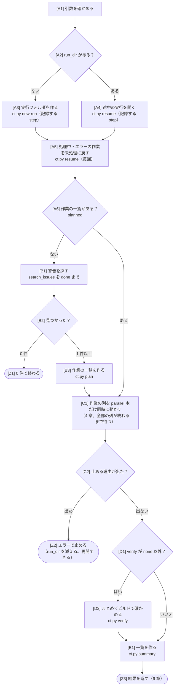
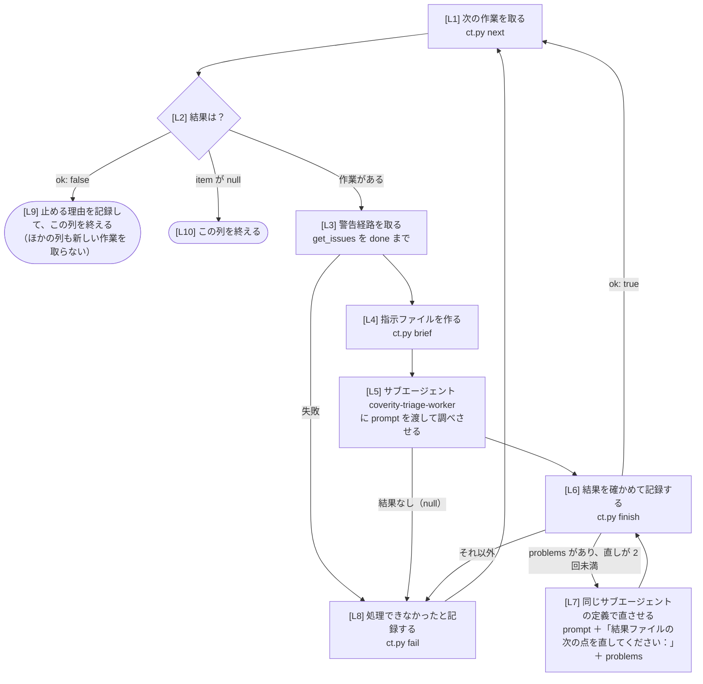

# dynamic workflow `coverity-triage-run` の構造

`/coverity-run`（スキル）と同じトリアージを、GitHub Copilot CLI の **dynamic workflow**（実験的な機能）で動かすときの構造です。
**このファイルが正本です。** 人はこのファイルを見て直し、AI はこのファイルに合わせて [`coverity-triage-run/extension.mjs`](coverity-triage-run/extension.mjs) を書きます。

- 直し方：このファイルの図と表を直してから、AI に「`workflow/coverity-triage-run.md` に合わせて `extension.mjs` を直して」と頼みます。
- 図の四角の中の `[A1]` などの記号（ノード ID）は、`extension.mjs` のコメント `// [A1]` と 1 対 1 で対応します。ノードを足したり消したりしたら、表も直します（`tests/test_workflow.py` が、図・表・`extension.mjs` の記号と段階がそろっているかを確かめます）。
- 使い方と入れ方は [README の「オプション：Copilot CLI の dynamic workflow」](../../../README.md#オプションcopilot-cli-の-dynamic-workflow) にあります。

## 1. 登録する内容（`meta`）

| 項目 | 値 |
|---|---|
| 名前（`name`） | `coverity-triage-run` |
| 説明（`description`） | Coverity の警告を 1 件ずつサブエージェント `coverity-triage-worker` に調べさせ、修正案と逸脱コメント案を作り、一覧 summary.md を作る（/coverity-run と同じ処理）。引数は 2 章 |
| 上限（`limits`） | 書かない（使う人が実行のときに決める。公式の指針「費用が分かっていない上限は書かない」に従う） |

### 段階（`phases`）

| 段階 | 内容 |
|---|---|
| 準備 | 実行フォルダを作る、または途中の実行を再開する |
| 検索 | Coverity で警告を探す |
| 計画 | グループ化して作業の一覧を作る |
| 調査 | 作業ごとにサブエージェントが調べる |
| 検証 | （オプション）修正案をまとめてビルドで確かめる |
| 一覧 | 一覧 summary.md を作る |

## 2. 引数（`argsSchema`）

`repo_root` か `run_dir` のどちらかが要ります。

| 引数 | 型 | 内容 | `ct.py new-run` の引数 |
|---|---|---|---|
| `repo_root` | string | 対象リポジトリの一番上のフォルダ（絶対パス）。新しく始めるとき | `--repo` |
| `run_dir` | string | 途中の実行の実行フォルダ（絶対パス）。続きから再開するとき。ほかの引数は使わない | — |
| `filter` | string | 条件ファイルの名前かパス（例 `misra.yaml`） | `--filter` |
| `impact` | string[] | Impact（例 `["High"]`） | `--impact` |
| `checker` | string[] | チェッカー名（`*` 可） | `--checker` |
| `status` | string[] | トリアージの Status | `--status` |
| `classification` | string[] | トリアージの Classification | `--classification` |
| `action` | string[] | トリアージの Action | `--action` |
| `limit` | integer | 件数の上限 | `--limit` |
| `verify` | `none` / `build` / `build+analyze` | ビルドでの検証 | `--verify` |

## 3. 全体の流れ

## 4. 作業の列（1 本の中の流れ）

列の数は、`ct.py plan`（再開のときは `ct.py resume`）の結果の `parallel`（設定 `parallel`、既定 1）です。
`ct.py next` が作業ごとに別の修正用のコピーを用意するので、列どうしはぶつかりません。

## 5. ノードと処理

「step」は `ctx.step`（結果を記録し、再開のときは記録した値を使う）、「毎回」は再開のときにもやり直す処理です。
`ct.py` と `coverity-triage-call` は、拡張機能の中から子プロセスとして動かします（7 章）。

| ノード | 処理 | 使うもの | 失敗したとき |
|---|---|---|---|
| A1 | `repo_root` か `run_dir` があるかを確かめる | — | エラーで止める |
| A3 | 実行フォルダを作る。2 章の引数を渡す | step `start-v1`：`ct.py new-run` | エラーで止める |
| A4 | 途中の実行を開く | step `start-v1`：`ct.py resume --run` | エラーで止める |
| A5 | 前の試行で処理中・エラーのまま残った作業を未処理に戻す | 毎回：`ct.py resume --run` | エラーで止める |
| B1 | 警告を探して `issues_file` に保存する。`done` が true になるまで同じ引数で呼ぶ | 毎回：`coverity-triage-call search_issues`（`repo_root`、`filter_file`、`output_file` = `issues_file`） | エラーで止める |
| B2 | `found` が 0 なら終わる | — | — |
| B3 | 作業の一覧を作る | 毎回：`ct.py plan` | エラーで止める |
| C1 | 4 章の列を `parallel` 本、同時に動かす | `ctx.parallel` | — |
| C2 | どれかの列が止める理由（L9）を記録したら止める | — | — |
| D2 | 修正案をまとめてビルドで確かめる | 毎回：`ct.py verify` | エラーで止める |
| E1 | 一覧を作り、修正用のコピーを片付ける。処理できなかった作業と理由を読む | 毎回：`ct.py summary`、`ct.py status` | エラーで止める |
| L1 | 次の作業を取り、修正用のコピーを用意する | 毎回：`ct.py next` | L9 |
| L3 | 警告経路を `item_dir` に保存する。`done` が true になるまで同じ引数で呼ぶ | 毎回：`coverity-triage-call get_issues`（`repo_root`、`stream`、`cids`、`output_dir` = `item_dir`） | L8 |
| L4 | 指示ファイル `brief.md` を作る | 毎回：`ct.py brief` | L8 |
| L5 | `brief` の `prompt` をそのまま渡す | `ctx.agent`（`agent`: `coverity-triage-worker`、`label`: `<作業>#<attempt>`） | L8 |
| L6 | 結果ファイルを確かめ、差分・ブランチ・詳細レポートを作る。`warnings` は覚えておき、6 章の結果に入れる | 毎回：`ct.py finish` | L7 か L8 |
| L7 | 直させる（2 回まで） | `ctx.agent`（`label`: `<作業>#<attempt>-fix<回>`） | L8 |
| L8 | 処理できなかったと記録する。理由を添える | 毎回：`ct.py fail --reason` | エラーで止める |

- サブエージェントの `label` には、`ct.py next` が返す試行の回数（`attempt`）を入れます。同じ `label` と prompt の呼び出しは 1 つにまとめられる（公式仕様）ため、やり直しのときに前の結果が使い回されないようにするためです。
- 進み具合は `ctx.log` で、作業が終わるたびに 1 行（例「20001: 修正を推奨（確信度 高）」）を出します。
- 人への質問はしません（`/coverity-run` と同じ。夜間に人がいなくても進められるように）。反映（`/coverity-apply`）はしません。

## 6. 結果（返す値）

| 項目 | 内容 |
|---|---|
| `run_dir` | 実行フォルダ |
| `summary` | 一覧 `summary.md` のパス（0 件で終わったときは null） |
| `found` | 見つかった警告の数（再開で検索をしなかったときは null） |
| `counts` | 作業の数（状態ごと） |
| `recommended` | 推奨の数（修正・逸脱） |
| `errors` | 処理できなかった作業と理由 |
| `warnings` | 作業ごとの `warnings`（L6） |
| `verify` | ビルドでの検証の結果（使わないときは null） |
| `next` | 次にすること（`summary.md` の承認欄を確かめ、`/coverity-apply` で反映する） |

## 7. 拡張機能の作り（公式仕様に従うところ）

| 項目 | 内容 | 出典 |
|---|---|---|
| 置き場所 | `~/.copilot/extensions/coverity-triage-run/extension.mjs`。`ct.py install-workflow` がこのフォルダを写し、`ct.py` と MCP サーバの場所を書いた `paths.json` を隣に置く | GitHub Docs「About extensions for Copilot CLI」、SDK `docs/extensions.md` |
| 登録 | `defineWorkflow({ meta, run })` の戻り値を `joinSession({ workflows: [...] })` に渡す | SDK `docs/workflows.md` |
| 引数 | `meta.argsSchema` は `type`・`required`・`enum`・`properties`・`items`・`anyOf` だけを使う（それ以外は確かめられない）。本体でも確かめる | SDK `docs/workflows.md`（Declaring an argument shape） |
| サブエージェント | `ctx.agent(prompt, { label, agent })`。失敗は例外ではなく `null` で返る | SDK `docs/workflows.md`（Subagent calls） |
| 同時に動かす | `ctx.parallel(thunks)`。投げた thunk は `null` になる。取り消しと実行基盤の失敗は全体が止まる | SDK `docs/workflows.md` |
| 段階 | `ctx.phase(title)` は実行全体で 1 つなので、列の中では呼ばない（列の区別は `label` と `ctx.log`） | SDK `docs/workflows.md` |
| 再開 | 実行基盤の再開は本体を最初からやり直す。`ctx.step` の key（`start-v1`）で記録した値を使う。key の意味を変えたら版を上げる（`start-v2`） | SDK `docs/workflows.md`（`ctx.step`） |
| 取り消し | 子プロセスに `ctx.signal` を渡す | SDK `docs/workflows.md`（`ctx.signal`） |
| 標準出力 | 拡張機能の標準出力は JSON-RPC 用なので `console.log` を使わない | SDK `docs/agent-author.md`（Gotchas） |
| 環境変数 | Copilot CLI は機微な環境変数を拡張機能から外す。認証情報の環境変数（既定 `COV_USER`、`COV_AUTH_KEY`）は `requestedEnvironmentVariables` で頼む（外されていない名前なら確認は出ない） | SDK `docs/extensions.md` |
| MCP のツール | 拡張機能から MCP のツールを呼ぶ公式の方法は無いため、MCP サーバと同じ関数を動かすコマンド `coverity-triage-call`（MCP サーバのパッケージに同梱。Coverity への書き戻し `update_triage` は含めない）を子プロセスで動かす | — |
